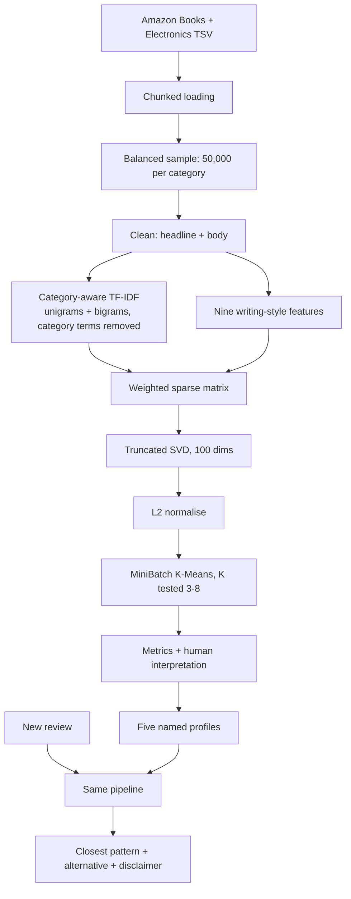

# ReviewLens

**See how product reviews are written, what customers complain about, where opinions clash, and which reviews deserve a second look, without needing a "useful / not useful" label.**

ReviewLens is an NLP prototype with a local web dashboard. It has three parts:

1. **Pattern model.** Learns five recurring review-writing patterns from 100,000 Amazon reviews (Books and Electronics) and assigns any new review to the closest one.
2. **Analysis suite.** Loads a review file and finds complaint groups, contradicting opinions, warning signals and a handful of evidence-backed insights.
3. **Dashboard.** One app for both: load or upload a dataset, run the analysis, browse the evidence, check a single review.

> **Read this first.** The pattern model returns the closest learned pattern. It does not say a review is useful, truthful or high quality, and it gives no probability. Everything in the analysis suite is **preliminary and heuristic**: nothing has been checked against ground truth, and the warning signals are not a fake-review detector.

## Contents

- [Quick start](#quick-start)
- [Using the dashboard](#using-the-dashboard)
- [API](#api)
- [The pattern model](#the-pattern-model)
- [The analysis suite](#the-analysis-suite)
- [Results so far](#results-so-far)
- [Verification](#verification)
- [Revision history](#revision-history)
- [Data and licence](#data-and-licence)
- [Repository structure](#repository-structure)
- [Limitations](#limitations)
- [Technology](#technology)

## Quick start

You need Python 3.11 and Node.js. The trained pattern model is in `models/`, so the app starts without any raw data. The analysis suite needs a local review file (see [Data and licence](#data-and-licence)).

```bash
# 1. Backend, from the repo root (models and reports load relative to the working directory)
pip install -r requirements.txt
python3 -m src.server              # http://127.0.0.1:8001

# 2. Dashboard, in a second terminal
cd frontend
npm install
npm run dev                        # http://localhost:5173, proxies the API calls to :8001
```

Then open the dashboard, choose **Load demo dataset**, and press **Run analysis**. A run takes about 1 to 3 minutes. The first run downloads two small models (sentence embeddings and an NLI model) from Hugging Face; both run on the CPU.

Use the pattern model from Python:

```python
from src.reviewlens_inference import ReviewLens

reviewlens = ReviewLens("models")
print(reviewlens.analyze(
    "I have used these headphones for six months. The battery lasts eight hours, "
    "but the earcups become uncomfortable after long use."
))
```

## Using the dashboard

### The dataset bar

The bar at the top is the one place that says what is loaded and what you can do with it.

- The **dataset chip** shows the file name, review count and kind: `demo sample` or `uploaded file`.
- **Change dataset** opens a small menu: upload a CSV, TSV, TXT or XLSX file, or reload the demo.
- The **main button** changes with the state: *Load demo dataset*, *Run analysis*, *Running 2 of 4*, *Re-run analysis*.
- While a run is going, an inline stepper shows the four steps (complaint clusters, contradictions, suspicious signals, insights) and the run time when it finishes.

### What an upload can and cannot do

Uploaded files are cleaned (with every dropped or blanked value counted), then browsable: counts, filters, matching reviews and the writing-pattern mix. They are **not analysed**. While an upload is active, every analysis page shows one message, "Not analysed", and the server answers those endpoints with `409`. Load the demo dataset to see analysis results again.

An upload needs a text column (`review_body` or `review_text`). It can also have `review_id`, `product_id`, `product_title`, `product_category`, `star_rating` (or `rating`), `review_date`, `helpful_votes`, `total_votes` and `verified_purchase`. Missing columns give blanks, never a crash.

### Pages

| Page | What it shows |
| --- | --- |
| **Overview** | **Dataset**: filters (product, rating, date), counts, the writing-pattern mix, and the matching reviews. **Findings**: key discoveries, complaint clusters, top contradictions, suspicious-review counts. The filters apply to the Dataset part only; the Findings are full-sample results and say so. |
| **Complaints** | Complaint clusters with top terms, size, sentiment mix and the original reviews per cluster. A cluster that holds over half of all clustered reviews is labelled "Mixed complaints, no single theme". |
| **Contradictions** | Opposing sentences on the same product and aspect, side by side, with the evidence, a possible interpretation and what is unknown. |
| **Suspicious Reviews** | Heuristic warning signals with the reason for each flag, similar reviews, and a *Dismiss flag* action that keeps the flag in the data. |
| **Insights** | Short findings with numerators and denominators and the excerpts behind them. Types without enough evidence are omitted, not padded. |
| **Check a review** | Paste a review or pick an example. You get the closest writing pattern, its informational value, the next closest pattern, and how common that pattern is in the loaded dataset. |

Details that tie the pages together:

- **Product names, not ids.** Product ids are opaque codes. The app shows the product title and keeps the id as the key for filters, links and reports (it appears in hover text, and in brackets when two products share a title).
- **Linked insights.** *Investigate* on a discovery opens the page that holds its evidence, already filtered to that cluster, product or aspect.
- **Fresh results.** Every page refetches when a run finishes.
- **Trustworthy numbers.** Contradictions are counted as unique review pairs and as aspect matches. Warning flags always show how many match the phrase "five stars".

## API

The stdlib server listens on `127.0.0.1:8001`. Every response is strict JSON (no `NaN`), and every failure returns `{"error": "..."}` with a status code. Routes ignore query strings.

| Method and path | Purpose |
| --- | --- |
| `POST /analyze` | `{"text": "..."}` returns the closest writing pattern. Body limit 100 KB. |
| `GET /app/status` | Dataset, run job, steps, `results_for`, `results_version`. |
| `GET /app/view?product=&rating=&date_from=&date_to=` | Counts, matching reviews, pattern mix and filter options for the active dataset. |
| `GET /app/overview` | Overview findings for the demo sample. |
| `POST /app/load-demo`, `POST /app/upload`, `POST /app/run` | Load the demo, upload a file (`X-Filename` header), start the analysis job. |
| `GET /complaints`, `/complaints/unclustered`, `/complaints/cluster/<id>/reviews` | Complaint clusters and their reviews. |
| `GET /contradictions`, `/contradictions/review/<id>` | Contradictions and one review. |
| `GET /suspicion`, `/suspicion/similar/<id>`; `POST /suspicion/dismiss` | Warning signals, similar reviews, dismiss a flag. |
| `GET /insights`, `/insights/all?type=`, `/insights/evidence/<id>` | Insight cards and their evidence. |

Analysis routes (`/complaints*`, `/contradictions*`, `/suspicion*`, `/insights*`) return `409` while an uploaded file is active. A bad body, unknown id or bad filter returns `400` or `404` with a message.

`/analyze` returns `review_pattern`, `description`, `informational_value`, `alternative_pattern`, `closest_cluster`, `distance_to_closest_cluster` and a `note`. The distance is an internal diagnostic; do not present it as confidence or accuracy.

```bash
curl -s -X POST http://127.0.0.1:8001/analyze \
  -H "Content-Type: application/json" \
  -d '{"text": "Great sound and comfy. Five stars."}'
```

## The pattern model

Product-review data rarely has a trustworthy "useful" label: helpful votes depend on popularity, age and visibility. So ReviewLens treats the task as unsupervised pattern discovery and applies human interpretation only after clustering.

| Pattern | What it looks like | Informational value |
| --- | --- | --- |
| Balanced Evaluative Review | Weighs positive and negative points | Moderate to high |
| Extended Analytical Review | Long, multi-sentence analysis | High |
| Concise General Opinion | Brief praise, criticism or rating-led opinion | Low to moderate |
| Long-Term Usage Experience | Evidence from use over time, specific performance details | High |
| Personal Experience and Recommendation | First-person experience and recommendation language | Moderate |



**Training** (in [notebooks/ReviewLens_Training.ipynb](notebooks/ReviewLens_Training.ipynb), Colab, needs the raw TSVs):

1. **Cleaning.** Join headline and body, decode HTML entities, strip tags and URLs, lowercase, drop texts under 15 characters. Negations (`not`, `no`, `never`) are kept on purpose.
2. **Category-aware text features.** Plain TF-IDF groups reviews by topic ("author", "battery"). So the vocabulary drops terms that are at least 0.2% frequent in one category and at least five times more frequent there than in the other: 4,052 terms removed, 75,948 text features kept.
3. **Nine writing-style features.** Log word count, sentence count, vocabulary diversity, numeric-detail rate, first-person rate, long-term-use language, comparison rate, contrast (pros and cons) rate, exclamation count. Standardised, L2-normalised and weighted by 0.8.
4. **Dimensionality reduction.** Truncated SVD to 100 components (seed 42), 50.3% explained variance, then L2 normalisation.
5. **Clustering.** MiniBatch K-Means. K = 3 to 8 were compared on silhouette, Davies-Bouldin, size balance and representative reviews. K = 5 was chosen.

**Inference** runs the same pipeline on one review and takes the nearest of five cluster centres. The raw data is not needed.

**Internal metrics** (there are no ground-truth labels, so there is no accuracy, precision, recall or F1):

| Metric | Result | Meaning |
| --- | ---: | --- |
| Silhouette (K = 5) | 0.1785 | Positive separation in noisy text |
| Davies-Bouldin (K = 5) | 1.9654 | Lower is better |
| Cluster-size range | 14% to 30% | No tiny or dominant cluster |
| SVD explained variance | 50.3% | Structure kept after compression |

Helpful votes were checked only after clustering as a sanity check, never as a target. The Extended Analytical cluster had the longest reviews and the highest helpful ratios. That is correlation, not proof of usefulness.

## The analysis suite

All modules read the first 20,000 rows of the local Electronics file, and all write to `reports/`.

| Module | Folder | What it does |
| --- | --- | --- |
| Load and clean | `batch/` | Chunked reading, one schema, and a count for every dropped or blanked value (empty text, bad rating, bad date, bad votes, unrecognised `verified_purchase`, duplicate id, malformed line). |
| Complaint discovery | `complaints/` | Takes reviews rated 1 to 3, embeds them (all-MiniLM-L6-v2), clusters with HDBSCAN (KMeans fallback). Labels are the words that set a cluster apart from all complaints, not the words every complaint uses. |
| Contradictions | `contradictions/` | Splits reviews into sentences, keeps those naming an aspect (battery, sound, comfort and so on), scores polarity with VADER, pairs a positive with a negative on the same product and aspect, then checks each pair with an NLI model. Kept: contradiction score at least 0.9 and the same aspect keyword in both sentences. |
| Suspicious signals | `suspicion/` | Exact duplicates, near-duplicates, semantic similarity, promotional wording, reviewer activity (5 or more reviews a day), review bursts. Exact and semantic matches count as one signal. 0 signals is "No signals", 1 Low, 2 Medium, 3 or more High. |
| Insights | `insights/` | Turns the outputs above into cards with real numbers and excerpts, ranks them, and keeps at most two per type on the overview. A catch-all cluster never becomes an insight. |
| Dashboard state | `dashboard/` | Dataset, run job, uploads, filters, writing-pattern mix, product names. |
| Usefulness experiment | `experiments/` | TF-IDF and logistic regression on a vote-derived label (helpful share at least 0.6, at least 5 votes), against a majority baseline. Research only: it is not part of the app. |
| Evaluation | `evaluation/` | Dataset report, n-gram report, quality checks, model card. |

Run the steps without the dashboard:

```bash
python -m complaints.run
python -m contradictions.run
python -m suspicion.run
python -m insights.run
python -m evaluation.quality_checks   # reruns the pipeline and rewrites reports/ (about 2-3 min)
python -m evaluation.model_card       # MODEL_CARD_RESULTS.md and model_card_metrics.json
```

## Results so far

Measured on the local Electronics sample: the first 20,000 rows for the analysis suite, the first 500,000 rows for the usefulness experiment. Source: `model_card_metrics.json` and `reports/`.

| Measure | Value | Note |
| --- | ---: | --- |
| Usefulness experiment (unigram, best) | accuracy 0.8179, macro-F1 0.6863 | Vote-derived label. Majority baseline macro-F1 is 0.4399 |
| Complaint clusters | 2 clusters, 819 clustered, 3,965 unclustered | One cluster (734 reviews) is a catch-all with no single theme; cluster quality is not evaluated |
| Contradictions | 420 review pairs (567 aspect matches) | NLI contradiction at least 0.9, same keyword in both sentences |
| Suspicion flags | 5,864 flagged (4,799 match "five stars") | 1,420 are Medium or High. "Five stars" is often a rating headline, so this count is inflated |
| Insights | 33 candidates, 4 on the overview | |
| Quality checks | 15 pass, 2 not verified | See below |

Full numbers, error analysis and limits: `MODEL_CARD_RESULTS.md`, with a one-page version in `MODEL_CARD_ONE_PAGE.pdf`.

## Verification

```bash
python -m evaluation.quality_checks
```

Each check ends as PASS, FAIL or NOT VERIFIED, with its evidence, in `reports/quality_check.md`. There are 17 results:

- **Pipeline and data:** the batch pipeline completes; cluster links match the raw text; contradiction quotes are real substrings; flagged reviews reproduce their signals; dashboard numbers equal the report numbers.
- **Uploads:** empty file, malformed file (counted, no crash), wrong columns, a tiny file (no fake clusters), a second upload (old results hidden).
- **API:** 11 endpoints return strict JSON; malformed requests get JSON errors; analysis endpoints refuse while an upload is active.
- **Signals and counts:** a duplicate pair after short reviews is found; the contradiction pair count agrees across report, API and dashboard.
- **Not verified (2):** the original usefulness prediction and the original fake-review detector, because neither exists in this project.

Quick self-checks that need no data: `python -m batch.schema`, `python -m suspicion.signals`, `python -m dashboard.products`. Frontend build: `cd frontend && npm run build`. A browser walk-through of every page is recorded in `reports/frontend_test.md`.

## Revision history

| Version | What changed |
| --- | --- |
| **1. Pattern model** | Unsupervised model, five patterns, notebook, artifacts, stdlib API, first dashboard (paste a review, compare pattern mixes). |
| **2. Analysis suite** | Batch loading, usefulness experiment, complaint discovery, contradiction investigator, suspicious-review signals, insight engine, dashboard with upload and filters, evaluation and model card. |
| **3. Audit and integration** (branch `fix/integrate-dashboard`) | An audit of version 2 found defects and a dashboard that felt bolted on. Fixes below. |

**Version 3 in detail**

| Area | Before | After |
| --- | --- | --- |
| Near-duplicate signal | Compared the wrong rows after short reviews were filtered out: 26 flags, all spurious | Rows stay aligned; 2 real flags |
| Unclustered list | Invalid JSON (`NaN`) broke the page | Strict JSON everywhere |
| Cluster labels | Praise words ("good", "quality") named complaint clusters; a catch-all became an insight | Labels use distinctive words; a cluster over 50% of clustered reviews is "no single theme" and kept out of insights |
| Contradiction count | 567 rows described as pairs | 420 unique pairs, 567 aspect matches, stated separately |
| Warning headline | 5,880 flags presented as one number | Flagged total plus the share matching "five stars" |
| Server | Some bad requests dropped the connection; query strings gave 404; unbounded bodies | JSON errors with status codes, body limits, query strings allowed |
| Uploads | Analysis pages showed demo results while an upload was active; some files crashed the status call | One "Not analysed" state, enforced by the server; missing columns tolerated; skipped lines counted |
| Dashboard layout | Duplicate headers, a button strip, stacked banners, per-page back buttons, filters that changed four tiles only, links without context | One dataset bar with a progress stepper, one page layout, filters beside a visible review table, linked and pre-filtered insights, refetch on new results |
| Analyze tab | Separate mini-app with 35 preset reviews analysed at startup | **Check a review**, tied to the loaded dataset; the Overview shows the writing-pattern mix |
| Product ids | Codes such as `B003EM8008` everywhere | Product titles, with the id kept as the key |
| Theme | Neon chart colours hard-coded in JavaScript, content capped at 1,280 px | Colours in the stylesheet, full-width layout, larger wordmark, magnifying-glass logo and favicon |
| Housekeeping | Cache ignored text changes; repeated CSV reads; unlocked shared state; unused imports; stale names and docs | Cache key covers text, cached reads, locks and atomic writes, lint clean, "Review Intelligence" renamed, docs and cards regenerated |
| Checks | 12 results | 17 results (5 new) |

## Data and licence

- The pattern model was trained on the Amazon US Customer Reviews files (Books and Electronics).
- The analysis suite reads `data/amazon_reviews_us_Electronics_v1_00.tsv`. Raw data is gitignored and not included.
- The Amazon data licence allows **academic research only**. Do not redistribute the raw files. Generated reports quote short review excerpts and product titles, so treat them as derived from that data too.

## Repository structure

```text
ReviewLens/
├── batch/              # loading, schema, batch prediction
├── complaints/         # complaint discovery
├── contradictions/     # contradiction investigator
├── suspicion/          # suspicious-review signals
├── insights/           # insight engine
├── experiments/        # usefulness experiment (TF-IDF n-grams)
├── evaluation/         # dataset report, quality checks, model card
├── dashboard/          # dataset and run state, uploads, filters, product names
├── frontend/           # React + Vite dashboard
├── models/             # trained pattern-model artifacts and profile JSON
├── reports/            # generated analysis outputs and test notes
├── notebooks/          # Colab training notebook
├── src/
│   ├── reviewlens_inference.py   # the pattern-model boundary
│   └── server.py                 # stdlib HTTP server
└── requirements.txt
```

`models/` holds `tfidf_vectorizer`, `svd_model`, `normalizer`, `clustering_model` and `style_scaler` (`.joblib`), plus `cluster_profiles.json` and `model_metadata.json` (see [models/README.md](models/README.md)). scikit-learn is pinned to **1.6.1**, the version that trained them. Keep each artifact under GitHub's 100 MB limit.

## Limitations

- The pattern model was trained on Books and Electronics only, and its five names are human interpretations of unsupervised clusters.
- Usefulness labels come from helpful votes: noisy and popularity-dependent. A manually annotated set is needed before any usefulness claim.
- Complaint clusters, contradictions and insights are not evaluated against ground truth. Treat them as exploration.
- Warning signals are heuristics. About 86% of flags involve promotional wording, and "five stars" is frequently a rating headline.
- The analysis suite runs on a head sample (20,000 rows), not a random one. Uploads are browsable but not analysed.
- The backend is a single-process stdlib server with no authentication or CORS, meant for local use.
- Review text in the dataset can contain raw HTML; the app strips it for display only.

**Next:** analysis on uploaded files, a sentiment layer, a labelled usefulness set, more categories.

## Technology

- **NLP and ML:** Python 3.11, pandas, NumPy, SciPy, scikit-learn 1.6.1, joblib, sentence-transformers (all-MiniLM-L6-v2), HDBSCAN, VADER, transformers (cross-encoder/nli-deberta-v3-small)
- **Backend:** Python standard-library HTTP server
- **Frontend:** React 18, Vite 5
- **Reports:** Markdown and JSON generated by the scripts above

The pattern model uses no deep learning. The suite's two pre-trained models run on the CPU.
